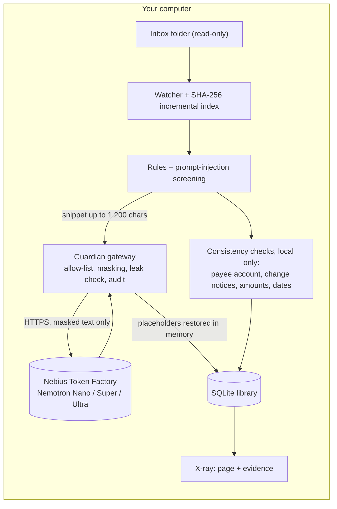

# MaryGuardian

[Русская версия](Readme.ru.md)

**A private paperwork bodyguard, powered by NVIDIA Nemotron on Nebius Token Factory.**

Drop invoices, contracts, letters and bills into a folder. MaryGuardian reads and files them, tracks every deadline and, more importantly, **checks the documents against each other**: does the bank account on this invoice match the contract? Did the vendor "just change" its details? Is there text on the page that a person cannot see but a model would obey? Every finding is shown **on the page itself**, with its evidence. When something needs action, it drafts the message for you, and **nothing is exported or sent without your approval**. Your personal data **never leaves your machine unmasked**.

> **Hackathon track:** Personal AI · **Demo:** `<DEMO_URL>` · **Video:** `<VIDEO_URL>`

## Why this is not another document organizer

Filing is the easy part, and it is also the part where a cloud model would normally have to see everything. The expensive mistakes happen *between* documents:

* an invoice that looks like last quarter's but pays a different bank account;
* a "we have updated our bank details" letter that arrives through the same channel as the invoice and therefore proves nothing;
* a PDF with hidden instructions, set in white text, written for your AI rather than for you.

MaryGuardian treats these as the product. Organizing is only the first layer.

## What it does

| Layer | What it does | Where it runs |
|---|---|---|
| **Document intelligence** | Reads PDF, DOCX, XLSX, PPTX, ODT/ODS, plain text, CSV and XML (UTF-8, UTF-16, Windows-1251). Rules recognise English, Russian and Kazakh phrasing. Sorts into 19 document types plus *other* (invoices, receipts, contracts, bank statements, payslips, tax, insurance, utility bills, product catalogs and datasets, …) and extracts issuer, number, dates, amounts, currency and deadlines | rules first, then Nemotron Nano / Super; **code validates every value** |
| **Document security** | Prompt-injection screening, including white-on-white text; masking of personal data and secrets before any cloud call | local |
| **Consistency & fraud detection** | Payee account against history and against your own confirmation, "details changed" notices, IBAN checksum, reused invoice numbers, outlier amounts, impossible dates | **local, no model involved** |
| **Assistant, human in the loop** | Answers questions over the library with `[id]` citations (Ultra); drafts letters and verification requests (Super); remembers the accounts you confirmed and the corrections you make; lists expired, expiring, duplicate and missing documents | Nemotron through the Guardian gateway; memory in local SQLite |

**Screens:** *Library* (views: Needs attention, Needs review, Expiring ≤ 30 days, Expired, Unsorted; collections with your own keywords; company merge) · *Cleanup* · *Ask* · *Profile* · *Single document* (pick files → draft → approve → save to the output folder) · *Activity* (files not re-read, model calls, tokens, tokens saved by the cache) · *Privacy* (what the cloud was sent) · *Settings* · *Audit log* · *X-ray* (below).

### Demo scenario: the changed bank account

The demo set contains four documents from one vendor:

1. `service_agreement_brightwave.pdf` and `INV-2026-0101_brightwave.pdf` show account **A** (ending `3000`).
2. `INV-2026-0106_brightwave.pdf` shows account **B** (ending `2051`).
3. `letter_brightwave_bank_update.pdf` says "our bank details have changed" and gives account B.

An organizer would simply file all four. MaryGuardian flags the new invoice as **high risk**:

> Bank account ending 2051 does not match the account(s) on file for Brightwave Energy GmbH: ending 3000 (first seen in service_agreement_brightwave.pdf; not independently confirmed). A notice in letter_brightwave_bank_update.pdf says the details changed, but it came through the same channel as the invoice, so it is not independent confirmation. No independent confirmation is recorded: verify by phone using a number from your own records.

Design decisions behind this:

* **Local and deterministic.** The cloud model never sees an account number (it sees `[IBAN_1]`). The database keeps only a salted SHA-256 fingerprint and the last four characters, never the number itself.
* **An explanation, not a score.** Every flag names the document, the account, the baseline and the reason.
* **Independent confirmation is explicit.** After you verify the account through a channel you trust, press *Confirmed by phone*. The account is recorded (and written to the audit log), the flag turns into an info note, and older invoices from the same vendor stay clean.
* **The human stays in the loop.** *Draft verification request* writes an email to the vendor through the Guardian gateway. You edit and approve it; the app sends nothing anywhere.

The checks, by flag code: `PAYEE_CHANGED`, `PAYEE_EXTRA`, `CHANGE_NOTICE`, `PAYEE_CONFIRMED`, `IBAN_INVALID`, `NUMBER_REUSED`, `AMOUNT_OUTLIER`, `DATES`, plus `INJECTION` from the screening step.

### X-ray: see what the agent saw

Open any PDF in **X-ray** to replay the analysis on the page itself:

| Colour | Meaning |
|---|---|
| green | a value the pipeline found (issuer, number, dates, amount, bank account) |
| red | a bank account that differs from the one on file |
| black ("Cloud view") | what Guardian replaces with placeholders before anything reaches the cloud, shown as `[IBAN_1]`, `[COMPANY_2]`… |
| orange | a phrase that looks like an instruction to an AI |
| purple | a line printed in white: invisible to a person, readable by a model |

`INV-2026-0999_evil_vendor.pdf` in the demo set hides its instructions in white text. The page looks like an ordinary invoice, and X-ray shows the two hidden lines. Guardian keeps the document away from every model. X-ray itself runs entirely on your machine; only the optional *Draft verification request* button calls a model, and it goes through Guardian like every other call.

## NVIDIA Nemotron on Nebius Token Factory

Every model call goes to the Token Factory OpenAI-compatible API. Work is tiered so cheap calls stay cheap and hard ones get the strongest model:

| Tier | Model (configurable in `.env`) | What it does here |
|---|---|---|
| **Nano** | `nvidia/NVIDIA-Nemotron-3-Nano-30B-A3B` | bulk classification of every new document (type, issuer, one-line summary) |
| **Super** | `nvidia/nemotron-3-super-120b-a12b` | field extraction when rules and Nano disagree or a value looks unreliable (dates, numbers, amounts, issuer); drafting letters and verification requests |
| **Ultra** | `nvidia/Nemotron-3-Ultra-550b-a55b` | questions over the whole library, with `[id]` citations |

**The model proposes, code decides.** A value from Super is accepted only if it verifiably appears in the document: dates must be real ISO dates, an amount must match a number in the text, and issuer and number must occur verbatim. Because placeholders are restored in memory before validation, this check works on masked prompts as well.

Where Token Factory helped: one OpenAI-compatible endpoint for three model sizes made tiering a config change instead of three integrations, and kept the app small (libcurl, no SDK). `scripts/check_models.sh --live` makes one real call per tier and prints the model, tokens and finish reason as proof of live execution.

## Privacy by construction: the Guardian gateway

A cloud model and a tax ID do not belong together, so the model never gets one.



1. **Default-deny actions.** Calling the cloud is an action (`llm_remote`) that must be on Guardian's allow-list.
2. **Masking before sending**, on two levels (`PII_MASK_LEVEL`):
   * `standard`: card numbers (Luhn-checked), IBAN, SSN/EIN, e-mail, phone numbers, Russian INN/SNILS/passport, Kazakh BIN/IIN, 9+ digit identifiers, dates of birth, **and secrets**: API keys, bearer tokens, JWTs, private keys, `password: …`.
   * `strict` (default): everything above plus **company names** (by label such as `From:` / `Поставщик:` and by legal form such as LLC, GmbH, ТОО, ИП), **document and account numbers**, **personal names and addresses by label**, BIC/SWIFT, and long token-like strings. A value found once is masked everywhere in the text, even without its label.
   * The application's own API key is registered as a protected value: it cannot appear in a prompt.
   * Amounts and dates stay readable on purpose; the model needs them to extract fields.
   * Placeholders map back to originals only in memory, for the duration of one request.
3. **Fail-closed.** After masking, the text is scanned again; if anything sensitive is still visible, the request is **not sent**.
4. **Prompt-injection screening** runs locally on the raw text. A suspicious document never reaches a model.
5. **Audit trail.** Every outbound request is logged with what the cloud actually saw (the masked text), a SHA-256 of the payload, token counts and latency. See the **Privacy** tab. Original values are never written to this log. Your confirmations and corrections are written to the audit log too.
6. **Your files are never modified or deleted.** The inbox is only read; approved drafts are written to a separate output folder, and the PDF editor refuses to overwrite its source.
7. **Budget guard.** A per-hour request cap protects your credits.
8. **Local server hardening.** The UI binds to loopback by default, every API call needs a per-run token, and the Host and Origin headers are checked.

What the test suite proves (`ctest`): a mock "provider" records every request body, and the test fails if any secret (IBAN, e-mail, SSN, protected name) appears in it. It also checks that the model's answer comes back with the real values restored, that masking is reversible and leaves nothing for the leak check to find, and that the database never contains a raw bank account number.

### Honest limits

* Structured identifiers are detected automatically. **Names and postal addresses cannot be reliably detected by rules**: `strict` catches them when they follow a label (`Employee:`, `Address:`, `Dear …`); anything else goes under *Settings → Always hide these* (or `PII_PROTECTED_TERMS`).
* Masked snippets of up to 1,200 characters (amounts, dates, descriptions, document types) do reach the model. That is the point of using it. Set `LLM_BACKEND=off` to keep everything on the machine; classification then falls back to rules, and all consistency checks still run.
* A flag is a reason to verify, not a verdict. The baseline for a vendor is your confirmed account or, failing that, the first document seen ("trust on first use"). If the very first document already carries a forged account, comparison cannot catch it; only your confirmed registry can. A notice from the same sender is never treated as confirmation.
* The app records your confirmation but cannot verify the phone call itself.
* Injection screening is a heuristic (English and Russian phrases), not a guarantee. Hidden-text detection finds near-white text; tiny or off-page text is not detected.
* In `strict` mode, company names that carry no legal form are masked only after they appear next to a label, so a question about such a name in *Ask* may not match its masked card.

## Quick start

**Fastest:** open the hosted demo at `<DEMO_URL>`. It holds synthetic data only, settings are read-only, and its state is shared between visitors.

**Run it yourself** (macOS or Linux; needs a C++17 compiler, CMake, MuPDF, SQLite, libcurl and pkg-config; nlohmann-json is taken from `third_party/` if it is not installed):

```bash
# macOS:           brew install mupdf sqlite curl pkg-config cmake
# Debian / Ubuntu: sudo apt install build-essential cmake pkg-config libmupdf-dev libsqlite3-dev libcurl4-openssl-dev

git clone <this repo> && cd <this repo>
cp .env.example .env                       # put your NEBIUS_API_KEY in it
scripts/check_models.sh --live             # verifies the key and the three model IDs
cmake -S . -B build && cmake --build build -j
./build/MaryGuardian --seed-demo           # writes 24 synthetic documents into mg_workspace/inbox; UI at http://127.0.0.1:8080
```

Run it from the repository root so that `.env` is found. `--seed-demo` also switches on demo mode (settings read-only, export disabled). To use your own documents, start `./build/MaryGuardian` without that flag and put files into `mg_workspace/inbox`; new files are picked up automatically every few seconds, and the inbox is never modified.

**Try it:** press **Scan**, open the *Needs attention* view, open `INV-2026-0106_brightwave.pdf` and click **Open X-ray**. Then open `INV-2026-0999_evil_vendor.pdf`, and look at the **Privacy** tab to see exactly what the cloud was sent.

Without a key the app still runs in rules-only mode: classification by pattern and all consistency checks, no model calls.

### Configuration

Everything comes from environment variables or `.env` (see [`.env.example`](.env.example)). Key points: `NEBIUS_API_KEY`, `NEBIUS_BASE_URL`, `NEMOTRON_MODEL_{NANO,SUPER,ULTRA}`, `LLM_BACKEND`, `PII_MASK_LEVEL`, `PII_PROTECTED_TERMS`, `LLM_MAX_REQUESTS_PER_HOUR`, `MG_DEMO_MODE`. No key or URL is hard-coded anywhere.

### Optional: offline local models (experimental, off by default)

Not needed with Nemotron. A host build with `-DMG_LOCAL_LLM=ON` adds download buttons in **Settings** for a small local classifier (Qwen3.5-2B, GGUF) and an optional scan summarizer (OCR-capable VLM + projector). Files come from `https://huggingface.co/` only, optionally SHA-256 verified; no document is ever sent. The default build does not include this.

## How it works

`watch → hash (SHA-256: renames and duplicates are free) → rules + injection check → Nano → escalate to Super only if unsure → code validates every value → file it → local consistency pass across the library`

* **Rules first, models second.** Dates, numbers and amounts come from deterministic extraction; models classify and summarize. A value found only by a weak rule (a bare "total") is escalated to Super, which can correct it.
* **Consistency is recomputed over the whole library** after every scan and after every correction or confirmation, so the result never depends on the order in which files arrived.
* **Retrieval happens in code**, not through model tools: the Ultra model only ever sees a short list of document cards.
* **Learns from corrections.** When you fix a type or collection, the fix is remembered per company and applied to future documents (stored locally in SQLite).
* **Caching everywhere.** Unchanged files are never re-read, model answers are cached by (model + prompt), and the Activity tab shows calls, tokens and tokens saved.
* **Human in the loop.** Drafts wait for your approval before anything is exported.

## Tests

```bash
cmake -S . -B build && cmake --build build -j && ctest --test-dir build --output-on-failure
```

(`-DMG_BUILD_APP=OFF` builds and runs only the tests that do not need MuPDF.)

* PII masking and reversibility, standard and strict, including secrets and no false positives on ordinary text
* the four-document bank-account scenario, including confirmation, idempotent recomputation and "no raw account number in the database"
* X-ray on real PDFs: field boxes land on the text, masked spans, changed account, injection phrases and white-on-white lines are found
* the demo set itself (hidden text, two different accounts)
* portable SHA-256 · end-to-end leak test against a mock OpenAI API (retries, `429`, reasoning models that return empty `content`, `json_object` fallback) · model downloader (SHA-256 mismatch deletes the file, URL allow-list) · field validation that rejects hallucinated values · correction memory

## What existed before the hackathon, and what is new

The C++ core (incremental indexer, SQLite library, MuPDF/Office text extraction, loopback HTTP server, Guardian allow-list and audit, a local Qwen classifier and OCR on macOS) predates the submission period. Everything below was built during it; the full table is in [`docs/WHAT_CHANGED.md`](docs/WHAT_CHANGED.md).

* Remote Nemotron backend with 3-tier routing, and field extraction with code-side validation
* PII-masking gateway: fail-closed leak check, outbound ledger, secret detection, strict entity masking
* Multilingual classification rules (English, Russian, Kazakh) with date, number, issuer and amount extraction
* **Consistency & fraud detection:** payee-account baseline and independent confirmation, "details changed" notices, IBAN checksum, reused numbers, outlier amounts, date checks
* **X-ray:** page view with evidence, cloud view and hidden-text detection; verification-request drafts behind human approval
* correction memory · background folder watcher · parallel classification
* Linux port (portable SHA-256, CMake, platform layer) · Privacy, Settings and Activity screens · optional model downloader
* synthetic dataset generated by the binary itself, with a bank-account-change scenario and a hidden-instruction PDF · test suite

## Limitations

X-ray works on PDFs (other formats are analysed, but not drawn). Legacy `.doc`/`.xls`, standalone images (only via the optional local summarizer) and `.eml` are not supported yet. The optional local OCR path returns a short summary of a scan, not a full transcription. Developed on macOS and built on Linux; the code also contains a Windows platform layer (`core/Platform.hpp`), but no Windows builds are provided. Single-user, local-first design: the public demo runs on synthetic data only and shares one workspace between visitors.

## License

See [`LICENSE`](LICENSE). MaryGuardian uses MuPDF (AGPL-3.0); third-party components and their licenses are listed in [`docs/THIRD_PARTY.md`](docs/THIRD_PARTY.md). The hosted demo runs the code in this repository.