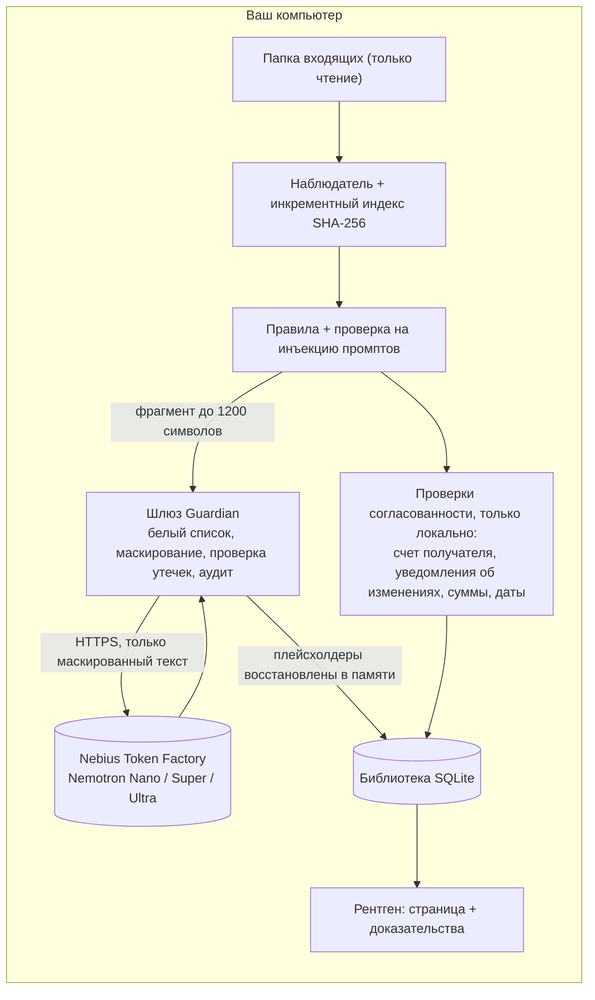

# MaryGuardian

[English verion](Readme.md)

**Персональный телохранитель для работы с документами, работающий на базе NVIDIA Nemotron в Nebius Token Factory.**

Складывайте счета, договоры, письма и квитанции в папку. MaryGuardian читает и сортирует их, отслеживает каждый срок и, что еще важнее, **проверяет документы на соответствие друг другу**: совпадает ли банковский счет в этом счете на оплату с указанным в договоре? «Просто изменил» ли поставщик свои реквизиты? Есть ли на странице текст, который не видит человек, но которому подчинится модель? Каждая находка показывается **прямо на самой странице**, вместе с доказательствами. Когда требуется действие, система составляет для вас черновик сообщения, и **ничего не экспортируется и не отправляется без вашего одобрения**. Ваши личные данные **никогда не покидают ваше устройство в немаскированном виде**.

> **Трек хакатона:** Персональный ИИ · **Демо:** `<https://maryguardian.combi.kz/>` · **Видео:** `<VIDEO_URL>`

## Почему это не просто очередной органайзер документов

Сортировка — это простая часть, и это также та часть, где облачной модели обычно пришлось бы видеть всё. Дорогостоящие ошибки происходят *между* документами:

* счет, который выглядит как счет за прошлый квартал, но оплачивается на другой банковский счет;
* письмо с текстом «мы обновили наши банковские реквизиты», которое приходит по тому же каналу, что и счет, и поэтому ничего не доказывает;
* PDF-файл со скрытыми инструкциями, набранными белым текстом, написанными для вашего ИИ, а не для вас.

MaryGuardian рассматривает именно это как продукт. Организация — это лишь первый слой.

## Что он делает

| Слой | Что делает | Где выполняется |
|---|---|---|
| **Интеллект для работы с документами** | Читает PDF, DOCX, XLSX, PPTX, ODT/ODS, обычный текст, CSV и XML (UTF-8, UTF-16, Windows-1251). Правила распознают английские, русские и казахские формулировки. Сортирует по 19 типам документов плюс *прочие* (счета, чеки, договоры, банковские выписки, расчетные листки, налоговые, страховые, счета за коммунальные услуги, каталоги товаров и наборы данных, …) и извлекает отправителя, номер, даты, суммы, валюту и сроки | сначала правила, затем Nemotron Nano / Super; **код проверяет каждое значение** |
| **Безопасность документов** | Проверка на инъекцию промптов, включая белый текст на белом фоне; маскирование личных данных и секретов перед любым обращением к облаку | локально |
| **Проверка согласованности и выявление мошенничества** | Сверка счета получателя с историей и вашим собственным подтверждением, уведомления об «изменении реквизитов», контрольная сумма IBAN, повторно использованные номера счетов, аномальные суммы, невозможные даты | **локально, модель не задействована** |
| **Ассистент, человек в цикле** | Отвечает на вопросы по библиотеке со ссылками `[id]` (Ultra); составляет черновики писем и запросов на проверку (Super); запоминает подтвержденные вами счета и внесенные вами исправления; выводит списки просроченных, истекающих, дублирующихся и отсутствующих документов | Nemotron через шлюз Guardian; память в локальной SQLite |

**Экраны:** *Библиотека* (представления: Требуют внимания, Требуют проверки, Истекают ≤ 30 дней, Просрочены, Не отсортированы; коллекции с вашими собственными ключевыми словами; объединение компаний) · *Очистка* · *Спросить* · *Профиль* · *Отдельный документ* (выбрать файлы → черновик → одобрить → сохранить в выходную папку) · *Активность* (файлы не перечитаны, вызовы модели, токены, токены, сохраненные кэшем) · *Конфиденциальность* (что было отправлено в облако) · *Настройки* · *Журнал аудита* · *Рентген* (ниже).

### Демо-сценарий: измененный банковский счет

Демо-набор содержит четыре документа от одного поставщика:

1. `service_agreement_brightwave.pdf` и `INV-2026-0101_brightwave.pdf` показывают счет **A** (оканчивающийся на `3000`).
2. `INV-2026-0106_brightwave.pdf` показывает счет **B** (оканчивающийся на `2051`).
3. `letter_brightwave_bank_update.pdf` сообщает «наши банковские реквизиты изменились» и указывает счет B.

Обычный органайзер просто подшил бы все четыре. MaryGuardian помечает новый счет как **высокорисковый**:

> Банковский счет, оканчивающийся на 2051, не совпадает со счетом (счетами) в досье на Brightwave Energy GmbH: оканчивающимся на 3000 (впервые замечен в service_agreement_brightwave.pdf; не подтвержден независимо). Уведомление в letter_brightwave_bank_update.pdf гласит, что реквизиты изменились, но оно пришло по тому же каналу, что и счет, поэтому не является независимым подтверждением. Независимое подтверждение не зафиксировано: проверьте по телефону, используя номер из ваших собственных записей.

Проектные решения, стоящие за этим:

* **Локально и детерминированно.** Облачная модель никогда не видит номер счета (она видит `[IBAN_1]`). База данных хранит только «соленый» отпечаток SHA-256 и последние четыре символа, но никогда сам номер.
* **Объяснение, а не оценка.** Каждый флаг указывает документ, счет, базовый показатель и причину.
* **Независимое подтверждение является явным.** После того как вы проверите счет через доверенный канал, нажмите *Подтверждено по телефону*. Счет фиксируется (и записывается в журнал аудита), флаг превращается в информационную заметку, а старые счета от того же поставщика остаются чистыми.
* **Человек остается в цикле.** *Черновик запроса на проверку* пишет электронное письмо поставщику через шлюз Guardian. Вы редактируете и одобряете его; приложение ничего и никуда не отправляет.

Проверки по коду флага: `PAYEE_CHANGED`, `PAYEE_EXTRA`, `CHANGE_NOTICE`, `PAYEE_CONFIRMED`, `IBAN_INVALID`, `NUMBER_REUSED`, `AMOUNT_OUTLIER`, `DATES`, плюс `INJECTION` с этапа проверки.

### Рентген: посмотрите, что видел агент

Откройте любой PDF в режиме **Рентген**, чтобы воспроизвести анализ прямо на странице:

| Цвет | Значение |
|---|---|
| зеленый | значение, найденное конвейером (отправитель, номер, даты, сумма, банковский счет) |
| красный | банковский счет, отличающийся от того, что есть в досье |
| черный («Вид из облака») | то, что Guardian заменяет плейсхолдерами до того, как что-либо попадет в облако, отображается как `[IBAN_1]`, `[COMPANY_2]`… |
| оранжевый | фраза, похожая на инструкцию для ИИ |
| фиолетовый | строка, напечатанная белым: невидима для человека, читаема для модели |

`INV-2026-0999_evil_vendor.pdf` в демо-наборе скрывает свои инструкции белым текстом. Страница выглядит как обычный счет, а Рентген показывает две скрытые строки. Guardian не подпускает документ ни к одной модели. Сам Рентген работает полностью на вашем устройстве; только опциональная кнопка *Черновик запроса на проверку* вызывает модель, и это происходит через Guardian, как и любой другой вызов.

## NVIDIA Nemotron в Nebius Token Factory

Каждый вызов модели идет в OpenAI-совместимый API Token Factory. Работа распределяется по уровням, так что дешевые вызовы остаются дешевыми, а сложные получают самую мощную модель:

| Уровень | Модель (настраивается в `.env`) | Что она делает здесь |
|---|---|---|
| **Nano** | `nvidia/NVIDIA-Nemotron-3-Nano-30B-A3B` | массовая классификация каждого нового документа (тип, отправитель, краткое описание в одну строку) |
| **Super** | `nvidia/nemotron-3-super-120b-a12b` | извлечение полей, когда правила и Nano не согласны или значение выглядит ненадежным (даты, числа, суммы, отправитель); составление черновиков писем и запросов на проверку |
| **Ultra** | `nvidia/Nemotron-3-Ultra-550b-a55b` | вопросы по всей библиотеке, со ссылками `[id]` |

**Модель предлагает, код решает.** Значение от Super принимается только в том случае, если оно проверяемо присутствует в документе: даты должны быть реальными датами в формате ISO, сумма должна совпадать с числом в тексте, а отправитель и номер должны встречаться дословно. Поскольку плейсхолдеры восстанавливаются в памяти перед валидацией, эта проверка работает и для маскированных промптов.

В чем помог Token Factory: одна OpenAI-совместимая конечная точка для трех размеров моделей превратила распределение по уровням в изменение конфига вместо трех интеграций и позволила сохранить приложение компактным (libcurl, без SDK). `scripts/check_models.sh --live` делает по одному реальному вызову на уровень и выводит модель, токены и причину завершения как доказательство реального выполнения.

## Конфиденциальность по дизайну: шлюз Guardian

Облачная модель и налоговый идентификатор не должны находиться вместе, поэтому модель никогда его не получает.



1. **Действия с запретом по умолчанию.** Обращение к облаку — это действие (`llm_remote`), которое должно быть в белом списке Guardian.
2. **Маскирование перед отправкой**, на двух уровнях (`PII_MASK_LEVEL`):
   * `standard`: номера карт (проверка по Луну), IBAN, SSN/EIN, электронная почта, номера телефонов, российские ИНН/СНИЛС/паспорт, казахские БИН/ИИН, идентификаторы длиной 9+ цифр, даты рождения **и секреты**: API-ключи, bearer-токены, JWT, закрытые ключи, `password: …`.
   * `strict` (по умолчанию): всё вышеперечисленное плюс **названия компаний** (по меткам вроде `From:` / `Поставщик:` и по организационно-правовой форме, такой как LLC, GmbH, ТОО, ИП), **номера документов и счетов**, **имена и адреса по меткам**, БИК/SWIFT и длинные строки, похожие на токены. Значение, найденное один раз, маскируется везде в тексте, даже без метки.
   * Собственный API-ключ приложения регистрируется как защищенное значение: он не может появиться в промпте.
   * Суммы и даты намеренно остаются читаемыми; они нужны модели для извлечения полей.
   * Плейсхолдеры сопоставляются с оригиналами только в памяти, на время одного запроса.
3. **Принцип fail-closed (отказ при сбое).** После маскирования текст сканируется снова; если что-то конфиденциальное всё еще видно, запрос **не отправляется**.
4. **Проверка на инъекцию промптов** выполняется локально на исходном тексте. Подозрительный документ никогда не попадает к модели.
5. **Журнал аудита.** Каждый исходящий запрос логируется с указанием того, что на самом деле увидело облако (маскированный текст), SHA-256 полезной нагрузки, количества токенов и задержки. Смотрите вкладку **Конфиденциальность**. Исходные значения никогда не записываются в этот журнал. Ваши подтверждения и исправления тоже записываются в журнал аудита.
6. **Ваши файлы никогда не изменяются и не удаляются.** Папка входящих только читается; одобренные черновики записываются в отдельную выходную папку, а PDF-редактор отказывается перезаписывать свой источник.
7. **Контроль бюджета.** Лимит запросов в час защищает ваши кредиты.
8. **Усиление защиты локального сервера.** Пользовательский интерфейс по умолчанию привязывается к loopback, каждый вызов API требует токен для каждого запуска, а заголовки Host и Origin проверяются.

Что доказывает набор тестов (`ctest`): мок-"провайдер" записывает каждое тело запроса, и тест падает, если в нем появляется какой-либо секрет (IBAN, e-mail, SSN, защищенное имя). Он также проверяет, что ответ модели возвращается с восстановленными реальными значениями, что маскирование обратимо и не оставляет ничего, что могла бы найти проверка на утечки, и что база данных никогда не содержит необработанного номера банковского счета.

### Честные ограничения

* Структурированные идентификаторы обнаруживаются автоматически. **Имена и почтовые адреса не могут быть надежно обнаружены правилами**: `strict` ловит их, когда они следуют за меткой (`Employee:`, `Address:`, `Dear …`); всё остальное попадает в *Настройки → Всегда скрывать это* (или `PII_PROTECTED_TERMS`).
* Маскированные фрагменты длиной до 1200 символов (суммы, даты, описания, типы документов) всё же попадают в модель. В этом и смысл её использования. Установите `LLM_BACKEND=off`, чтобы держать всё на устройстве; тогда классификация переключится на правила, а все проверки согласованности продолжат работать.
* Флаг — это повод для проверки, а не вердикт. Базовым показателем для поставщика является ваш подтвержденный счет или, за неимением такового, первый увиденный документ («доверие при первом использовании»). Если самый первый документ уже содержит поддельный счет, сравнение не сможет это выявить; это может сделать только ваш подтвержденный реестр. Уведомление от того же отправителя никогда не рассматривается как подтверждение.
* Приложение записывает ваше подтверждение, но не может проверить сам телефонный звонок.
* Проверка на инъекции эвристическая (английские и русские фразы), а не гарантия. Обнаружение скрытого текста находит почти белый текст; крошечный или находящийся за пределами страницы текст не обнаруживается.
* В режиме `strict` названия компаний, не имеющие организационно-правовой формы, маскируются только после того, как они появляются рядом с меткой, поэтому вопрос о таком названии в *Спросить* может не совпасть с его маскированной карточкой.

## Быстрый старт

**Самый быстрый способ:** откройте размещенное демо по адресу `<https://maryguardian.combi.kz/>`. Оно содержит только синтетические данные, настройки доступны только для чтения, а его состояние является общим для всех посетителей.

**Запустите самостоятельно** (macOS или Linux; требуется компилятор C++17, CMake, MuPDF, SQLite, libcurl и pkg-config; nlohmann-json берется из `third_party/`, если он не установлен):

```bash
# macOS:           brew install mupdf sqlite curl pkg-config cmake
# Debian / Ubuntu: sudo apt install build-essential cmake pkg-config libmupdf-dev libsqlite3-dev libcurl4-openssl-dev ibfreetype-dev libharfbuzz-dev libopenjp2-7-dev libjbig2dec0-dev libgumbo-dev libmujs-dev libjpeg-dev zlib1g-dev

git clone <this repo> && cd <this repo>
cp .env.example .env                       # поместите ваш NEBIUS_API_KEY сюда
scripts/check_models.sh --live             # проверяет ключ и три ID моделей
cmake -S . -B build && cmake --build build -j
./build/MaryGuardian --seed-demo           # записывает 24 синтетических документа в mg_workspace/inbox; UI по адресу http://127.0.0.1:8080
```

Запускайте из корня репозитория, чтобы нашелся `.env`. `--seed-demo` также включает режим демо (настройки только для чтения, экспорт отключен). Чтобы использовать свои документы, запустите `./build/MaryGuardian` без этого флага и положите файлы в `mg_workspace/inbox`; новые файлы автоматически подхватываются каждые несколько секунд, и папка входящих никогда не изменяется.

**Попробуйте:** нажмите **Сканировать**, откройте представление *Требуют внимания*, откройте `INV-2026-0106_brightwave.pdf` и нажмите **Открыть Рентген**. Затем откройте `INV-2026-0999_evil_vendor.pdf` и посмотрите на вкладку **Конфиденциальность**, чтобы увидеть, что именно было отправлено в облако.

Без ключа приложение всё равно работает в режиме "только правила": классификация по шаблонам и все проверки согласованности, без вызовов модели.

### Конфигурация

Всё берется из переменных окружения или `.env` (см. [`.env.example`](.env.example)). Ключевые моменты: `NEBIUS_API_KEY`, `NEBIUS_BASE_URL`, `NEMOTRON_MODEL_{NANO,SUPER,ULTRA}`, `LLM_BACKEND`, `PII_MASK_LEVEL`, `PII_PROTECTED_TERMS`, `LLM_MAX_REQUESTS_PER_HOUR`, `MG_DEMO_MODE`. Никакой ключ или URL нигде не захардкожены.

### Опционально: локальные офлайн-модели (экспериментально, отключено по умолчанию)

Не требуется при использовании Nemotron. Сборка хоста с `-DMG_LOCAL_LLM=ON` добавляет кнопки загрузки в **Настройках** для небольшого локального классификатора (Qwen3.5-2B, GGUF) и опционального суммаризатора сканирования (VLM с поддержкой OCR + проектор). Файлы берутся только с `https://huggingface.co/`, опционально проверяются по SHA-256; ни один документ никогда не отправляется. Сборка по умолчанию этого не включает.

## Как это работает

`наблюдение → хэш (SHA-256: переименования и дубликаты бесплатны) → правила + проверка на инъекции → Nano → эскалация до Super, только если есть сомнения → код проверяет каждое значение → сохранение → локальная проверка согласованности по всей библиотеке`

* **Сначала правила, потом модели.** Даты, числа и суммы берутся из детерминированного извлечения; модели классифицируют и суммаризируют. Значение, найденное только слабым правилом (голое "итого"), эскалируется до Super, который может его исправить.
* **Согласованность пересчитывается по всей библиотеке** после каждого сканирования и после каждого исправления или подтверждения, поэтому результат никогда не зависит от порядка поступления файлов.
* **Поиск происходит в коде**, а не через инструменты модели: модель Ultra видит только короткий список карточек документов.
* **Учится на исправлениях.** Когда вы исправляете тип или коллекцию, исправление запоминается для каждой компании и применяется к будущим документам (хранится локально в SQLite).
* **Кэширование везде.** Неизмененные файлы никогда не перечитываются, ответы модели кэшируются по (модель + промпт), а вкладка Активность показывает вызовы, токены и сохраненные токены.
* **Человек в цикле.** Черновики ждут вашего одобрения, прежде чем что-либо будет экспортировано.

## Тесты

```bash
cmake -S . -B build && cmake --build build -j && ctest --test-dir build --output-on-failure
```

(`-DMG_BUILD_APP=OFF` собирает и запускает только те тесты, которым не нужен MuPDF.)

* Маскирование и обратимость PII, standard и strict, включая секреты и отсутствие ложных срабатываний на обычном тексте
* сценарий с банковским счетом из четырех документов, включая подтверждение, идемпотентный пересчет и «отсутствие необработанного номера счета в базе данных»
* Рентген на реальных PDF: рамки полей попадают на текст, находятся маскированные диапазоны, измененный счет, фразы-инъекции и строки белым по белому
* сам демо-набор (скрытый текст, два разных счета)
* переносимый SHA-256 · сквозной тест на утечки с мок-API OpenAI (повторные попытки, `429`, reasoning-модели, возвращающие пустой `content`, фоллбэк на `json_object`) · загрузчик моделей (несовпадение SHA-256 удаляет файл, белый список URL) · валидация полей, отклоняющая галлюцинированные значения · память исправлений

## Что существовало до хакатона, а что нового

Ядро на C++ (инкрементный индексатор, библиотека SQLite, извлечение текста MuPDF/Office, HTTP-сервер loopback, белый список и аудит Guardian, локальный классификатор Qwen и OCR на macOS) существовало до периода подачи заявок. Всё, что ниже, было создано во время него; полная таблица находится в [`docs/WHAT_CHANGED.md`](docs/WHAT_CHANGED.md).

* Удаленный бэкенд Nemotron с 3-уровневой маршрутизацией и извлечением полей с валидацией на стороне кода
* Шлюз маскирования PII: безопасная проверка на утечки, журнал исходящих запросов, обнаружение секретов, строгое маскирование сущностей
* Многоязычные правила классификации (английский, русский, казахский) с извлечением даты, номера, отправителя и суммы
* **Проверка согласованности и выявление мошенничества:** базовый показатель счета получателя и независимое подтверждение, уведомления об «изменении реквизитов», контрольная сумма IBAN, повторно использованные номера, аномальные суммы, проверки дат
* **Рентген:** просмотр страницы с доказательствами, вид из облака и обнаружение скрытого текста; черновики запросов на проверку с одобрением человеком
* память исправлений · фоновый наблюдатель за папкой · параллельная классификация
* Порт под Linux (переносимый SHA-256, CMake, платформенный слой) · Экраны Конфиденциальности, Настроек и Активности · опциональный загрузчик моделей
* синтетический набор данных, сгенерированный самим бинарным файлом, со сценарием изменения банковского счета и PDF-файлом со скрытой инструкцией · набор тестов

## Ограничения

Рентген работает с PDF (другие форматы анализируются, но не отрисовываются). Устаревшие `.doc`/`.xls`, отдельные изображения (только через опциональный локальный суммаризатор) и `.eml` пока не поддерживаются. Опциональный локальный путь OCR возвращает краткое резюме скана, а не полную транскрипцию. Разработано на macOS и собрано под Linux; код также содержит платформенный слой для Windows (`core/Platform.hpp`), но сборки под Windows не предоставляются. Дизайн для одного пользователя, с приоритетом локальной работы: публичное демо работает только на синтетических данных и использует одно общее рабочее пространство для всех посетителей.

## Лицензия

См. [`LICENSE`](LICENSE). MaryGuardian использует MuPDF (AGPL-3.0); сторонние компоненты и их лицензии перечислены в [`docs/THIRD_PARTY.md`](docs/THIRD_PARTY.md). Размещенное демо запускает код из этого репозитория.